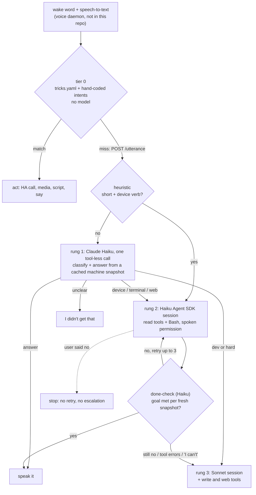

# voice-agent-router

A voice front end that answers each spoken request at the cheapest tier that can handle it. Plain commands never touch a model, questions get one Claude Haiku call, and only real jobs start a Claude Agent SDK session. In the room, a session that wants to change something asks out loud first. On my phone, a Sonnet worker with the house's own tools answers whatever no phrase matched: it does not ask, and everything that would go to another person is blocked ([exactly what it may do](docs/PHONE_WORKER.md#what-it-can-do-and-what-it-cannot)). The same voice pipes to the lights, the TV, the car, the phone, the cameras, mail, calendar, music and the desktop: [the connectors, how each is reached and what gates it](docs/CAPABILITIES.md).

> **Status: work in progress.** The system this comes from runs at my desk every day and keeps changing. This extracted copy passes its 95 offline tests. The room tiers have run against the live models. The phone worker they were extracted for has run in production since Oct 10; this repo's version of it has so far run only against fake devices and a stand-in SDK, never a live session. Expect rough edges and breaking changes.

## Why I built it

I wanted the Star Trek computer at my desk. Say "computer" from anywhere in the room and get things done: lights, the TV, "get the car ready", or "why won't the printer print". A smart speaker covers the first few, but it can't touch my own desktop, my scripts or my car, and a raw LLM with a shell is slow, costs money on every "lights off", and is one misheard TV line away from doing something I didn't ask for. So I built the part in between: a router that sends each request to the cheapest thing that can handle it, and asks before its agent tiers change anything (the phone worker is the one exception, below).

What I wanted:

1. Commands I say every day run instantly and cost nothing.
2. Questions get a short spoken answer, grounded in the machine's actual state.
3. Real work (pair the headphones, find out why the printer is offline) gets an agent with tools, but in the room nothing that writes, deletes or sends runs without a clear spoken yes.
4. My phone should not give up on a request the reflexes miss. It used to hand those to the phone's stock assistant, which cannot see my house, my calendar or my car. On 2026-10-10 I decided anything the phrases do not know should go to Claude instead. That worker has no one to ask mid-task, so its safety is a different shape: only the tools it was given, and a hard block on anything that goes to someone else.

It has been in daily use since August 2026. This repo is the routing core pulled out of that system and cleaned up so it runs on its own. Home-specific parts (Home Assistant entity ids, the Kodi library matcher, the wake word and speech pipeline) are not included; see [What is not in this repo](#what-is-not-in-this-repo). Version 2 adds the phone worker, a tool registry, the permission tiers and adapters for the car, Home Assistant, Kodi, mail, calendar, the phone and a food diary, all with fake backends so they test offline.

## How it works



**Tier 0: no model** (`router/tricks.py`, `examples/tricks.yaml`). A YAML list of phrase to action entries, reloaded when the file changes, so adding a phrase needs no restart. Phrases match the whole utterance ignoring case and punctuation, which is what Whisper gives you ("Movie night." vs "movie night"). A broken edit is logged and skipped; the last good set stays live. In production a set of hand-coded intents (media titles, percentages, chained commands like "lights 40 and AC 72") sits behind the YAML.

**Rung 1: Haiku classifies and often answers** (`router/ladder.py`). One tool-less call with a compact machine snapshot in the system prompt (`router/snapshot.py`: audio devices and volumes, bluetooth, printers, displays, temperatures, disks, failed services). "What's my volume" or "is the printer online" is answered with zero tool calls. The voice daemon blocks on this call, so there is a 1.05 s deadline: if Haiku has not returned, the daemon gets a silent ack and the answer is spoken when it arrives. The reply also carries a `done_when` condition that a later snapshot can check.

**Rungs 2 and 3: Agent SDK sessions that check their own work.** A headless session with Bash and read tools (rung 2, Haiku) or write and web tools too (rung 3, Sonnet). After every turn a cheap Haiku done-check compares the worker's report and a fresh snapshot against `done_when`, and re-prompts the same session with what is still missing, up to 3 rounds. A rung-2 attempt that misses its goal, hits two tool errors, or says "I can't" escalates to rung 3. It never de-escalates.

**Spoken permission, room sessions** (`router/permissions.py`). Every tool call in rung 2 and 3 goes through the SDK's `can_use_tool` callback:

- `bash_is_readonly()` proves a command is read-only or it asks. It is deny-by-default and shell-aware: pipelines and `&&` are split and every segment is checked; `$(...)`, redirects, subshells and newlines reject the whole line. It also knows that `curl -d` is a submission, `curl ... | sh` is download-and-execute, `git branch x` creates a branch, `sed 's/a/b/w f'` writes a file, and `PAGER=x git log` runs a program.
- Anything else is read out ("Run touch home Downloads/notes.txt?") and needs a clear yes. A "Yes." the speech layer marks as unclear (TV in the background) counts as no.
- One question per task. After a no, or no answer, every later write in that task is denied silently and the task stops. No goal-loop retry and no escalation into a fresh session that would ask again.

The tool roster is passed as `tools=`, never `allowed_tools=`. An `allowed_tools` entry auto-approves the tool before `can_use_tool` is consulted. I measured it: with `allowed_tools=['Bash']` a `touch` ran with no callback and no question.

**MCP server** (`mcp_server/voice_mcp.py`). Registered user-wide, so every Claude Code session I open gets `say`, `ask`, `listen`, `notify` and friends (11 tools). A long build in one terminal can say "tests passed" out loud, or ask me a question while I am across the room. Every tool returns a short plain string instead of raising, because the voice daemon restarts often and a hung tool hangs the session.

**Phone misses: a Sonnet worker** (`router/phone_worker.py`, [docs/PHONE_WORKER.md](docs/PHONE_WORKER.md)). My phone sends what its on-device recogniser heard to the desk. Tier 0 answers if a phrase matches. If it misses and the request says it is from the owner's phone (the client asserts that; the bearer token is the real boundary), the phone hears "On it." at once and a Sonnet Agent SDK session starts in the background with the house's tools: a phrase through the house, the car, Home Assistant and Kodi reads, phone timers and pages, food diary, calendar add, a mail draft, the web. It speaks one short sentence back. This path has no spoken yes, because the phone cannot answer one. What stands in for it is in `router/gate.py`: every tool is `auto`, `ask` or `blocked`, anything unnamed is refused, and send, reply, forward, RSVP, delete and share are blocked in every session. Its own tools, including the ones that write (a light, a destination for the car, a timer, a food-log line), run without a question. Run it offline with `python3 demo_phone.py`.

## Measured in production

From the live logs, 2026-09-07 to 2026-10-05 (4 weeks, one desk, one user). These are the 10-05 figures, left as published. I re-ran `tools/measure_log.py` on the same log cut at the end of Oct 5 and got 252 commands, 75% model-free, close to the table below (238, 76%; the original cutoff time was not recorded). After Oct 5 the log also holds scripted phone-worker tests, so a count over the whole file would not measure use. The curator log the second table came from has rolled since, so it cannot be re-run. `tools/measure_log.py` reproduces every number here from the raw logs (not published: they are a transcript of my house), and its docstring lists exactly which log lines count as what.

| | n | share |
|---|---:|---:|
| Commands handled with no model call (tier 0) | 182 | 76% |
| Commands sent to the model tiers | 56 | 24% |
| **Total commands that did something** | **238** | |

So about 3 in 4 spoken commands cost nothing. The model-free count is a floor: transport words like "pause" and "stop" are handled before routing and leave no outcome line.

What happened to the ones that reached the model tiers:

| | n |
|---|---:|
| Rung-1 Haiku classifications completed | 43 |
| ...answered on the spot | 7 |
| ...judged `unclear` and dropped | 34 |
| ...handed to a worker as a device job | 2 |
| Rung-1 calls that timed out (all in one run, during the lock-up below) | 6 |
| Short device commands that skipped rung 1 by keyword (straight to a worker) | 2 |
| Rung-2 Haiku agent sessions | 3 |
| Rung-3 Sonnet sessions | **0** |

The 56 posts outnumber the 51 rung-1 and keyword decisions because some went straight to the hands-free coding mode ([talk2code](https://github.com/JPInert/talk2code)) without a rung-1 call.

Two things stand out. Most of what reaches rung 1 is not a command at all: it is TV dialogue or room conversation that tripped the wake word, and rung 1 is the cheap filter that keeps it away from anything with tools. And in four weeks nothing needed Sonnet; every model call that did run was Haiku. Rung-1 latency was a median of 2.94 s, p90 3.88 s (n=43).

### The phone worker, counted separately

`tools/measure_phone_jobs.py` on the production log (read 2026-10-16, window 2026-10-10 19:04 to 2026-10-15 18:22):

| | n |
|---|---:|
| Phone jobs started | 67 |
| ...answered by a regex intercept ("go ahead", "confirm"), no model | 14 |
| ...started a Sonnet session | 53 |

The worker's own timer: median 8.6 s, p90 17.2 s (n=53). 49 of the 53 sessions fall on Oct 10 and 11, when I was building and testing it through the same endpoint, and the log cannot tell a test from a real request. So this is a count of jobs, not of use, and it says nothing about how often the answer was right. Details and the tool counts are in [docs/PHONE_WORKER.md](docs/PHONE_WORKER.md#how-often-it-ran).

## The three-day lock-up

The best bug this system has had, and the reason `server.py` has the health check it has.

**Symptom.** Nothing. `/health` was green, the HTTP server answered, RSS sat flat at 67 MB. What I eventually noticed was heat: the CPU was sitting at 67 °C on an idle desktop.

**Finding it.** One process was burning a full core. Every utterance in the log for the previous three days had the same shape: `ack=silent` at 1.05 s, then `rung1 failed: TimeoutError()` at exactly +180.00 s, the outer timeout. The SDK child process the wedged session held had been alive for 3 days 0 h 44 m, which dated the onset against the CPU time burned (3 d 0 h 46 m).

**Cause.** `SentenceSpeaker.feed()` (`router/speaker.py`) speaks a streaming reply sentence by sentence and merges short sentences into the next one. The first version did that by putting the short sentence back in front of the buffer. The split keeps the punctuation, so that restored the input byte for byte and the loop re-split the same prefix forever, with no allocation (hence the flat memory). Any reply whose first sentence was under 25 characters ("OK. Let me check...") triggered it. It ran on the asyncio loop thread that every Agent SDK call shares, so the process stayed up and the health endpoint, on its own thread, stayed green while nothing was ever scheduled again.

**Fix.** Short sentences wait in a separate `pending` slot and every pass consumes one sentence boundary, so the buffer strictly shrinks. Before restarting I confirmed the pre-fix repro never returned and that 500 fuzzed chunked streams finished with no wedges and no text lost. `tests/test_speaker.py` keeps the broken version and asserts that it wedges, so the regression test is proven to catch the bug, then runs the same 500-stream fuzz on the fix. CPU went from 67 °C to 49 °C.

**Lesson.** A health check that only proves the HTTP thread is alive proves nothing about the work. `server.py`'s `/health` here schedules a no-op on the SDK loop and fails if it does not come back in 2 s. The extract also cancels a classify future that times out instead of abandoning it.

## Other things production taught it

Each of these is a comment next to the code it changed.

- **One clarifying question, then stop.** It used to ask up to two follow-up questions. In the log, all 5 second-round answers came back `unclear` too, because those chains start on room conversation and each question just records more of the room. Now rung 1 gets one shot.
- **Haiku sometimes tries to call a tool when told to classify** an imperative ("make me a file..."). With no tools and `max_turns=1` the query died. `max_turns=2` lets it recover.
- **The done-check demanded raw command output** it could never see, judged the job unfinished, and the user heard the same answer twice. The prompt now says the worker's report of a command's output is the record.
- **"Find another way"** as the denial message made the worker retry the same write as a bigger compound command. The message now says stop.
- **Spoken prose plus `say` calls** meant hearing every job twice, half of it the model thinking out loud. The `say` tool is the only channel; prose is spoken only if the session never spoke.
- **Permission prompts read raw shell** ("touch tilde slash..."). `speak_cmd()` turns `~/` into "home" and `&&` into "then" for speech only; logs keep the raw command.

## Running it

```bash
pip install -r requirements.txt

python3 -m pytest -q                 # 95 tests, no model calls, no devices, no network
python3 demo.py --dry-run            # type utterances, see which tier claims them
python3 demo.py                      # real rungs via the Agent SDK (needs `claude` logged in)
python3 server.py                    # POST /utterance {"text": "..."} on 127.0.0.1:7782
python3 demo_phone.py                # the phone worker's gate and tools, scripted model, fake devices
python3 demo_phone.py --live "set a timer for ten minutes"   # real Sonnet, still fake devices
python3 phone_server.py --fake-backends                      # POST /phone, needs ROUTER_PHONE_TOKEN
```

```text
> Movie night.
  tier 0: trick 'movie night' (no model)
  [ha] light.turn_off {'entity_id': 'light.living_room'}
  [say] Enjoy the movie.
> dim the bedroom lamp
  rung 1 skipped: keyword says device job -> rung 2 worker
> what is the capital of France
  rung 1: would go to Haiku to classify
```

In `demo.py`, permission questions from rungs 2 and 3 are asked on the terminal, so you can watch a "no" stop a task:

```text
[terminal-1] ASK permission (Bash): Run touch .../workspace/hello.txt?
[terminal-1] permission denied (heard='no')
[terminal-1] rung=2 model=claude-haiku-4-5-20251001 elapsed=6.90s rounds=1 met=False
  [say] I stopped there — that needed your OK.
```

## Layout

```
router/tricks.py        tier 0: YAML phrase -> actions, hot reload, validation
router/ladder.py        rungs 1-3, done-check goal loop, permission callback, escalation
router/permissions.py   bash_is_readonly() and the speech-safe prompt helpers
router/speaker.py       streaming sentence speaker (the lock-up fix)
router/snapshot.py      compact machine-state snapshot, every probe on a short timeout
router/voice_io.py      say/ask over HTTP to the voice daemon, or on a terminal
router/gate.py          auto / ask / blocked tool tiers, the SDK's three layers, the two-yes plan slot
router/registry.py      one tool registry: writes, tier, dry-run, SDK server, policy
router/phone_worker.py  the phone-miss worker: prompt, SDK runner, one sentence back
router/phone_jobs.py    "On it." now, run in the background, collect later; owner-only
router/connectors/      adapter shapes: home, kodi, car, mail, calendar, phone, food, wish, hosted names
router/fakes.py         in-memory backends and a scripted model, so all of it tests offline
mcp_server/voice_mcp.py stdio MCP server: voice tools for any Claude Code session
server.py               POST /utterance, GET /health with a real loop probe
phone_server.py         POST /phone, POST /phone/pending, bearer token, loopback only
demo.py                 terminal front end
demo_phone.py           phone worker demo: offline script, or --live against fake devices
tools/measure_log.py    reproduces the numbers above from the production logs
tools/measure_phone_jobs.py  counts phone worker jobs from a daemon log
examples/tricks.yaml    sample tricks (placeholder entity ids)
docs/CAPABILITIES.md    the connectors: how each is reached, can it change state, what gates it
docs/PHONE_WORKER.md    the phone worker: flow, permissions, numbers, how to run and extend
```

## What is not in this repo

The production system around this core: the wake-word and speech daemon (openWakeWord, faster-whisper, a reSpeaker mic array, TTS, wake-confirmation gates tuned against recordings made in the room), the hand-coded intents for my media library, lights, TV and AC, the Home Assistant entity map and the Kodi library matcher, a session registry that lets the voice reach into Claude Code tabs already open on the desktop, and a hands-free "let's code" mode that speaks a live Claude Code session (published separately as [talk2code](https://github.com/JPInert/talk2code)). Also left out of the phone worker: the warm conversational session (it keeps three minutes of context and reopens the mic on a question), the hand-off runner behind `delegate`, build-a-tool-by-voice with staged install and rollback, the root-over-ssh phone helper, and the remote-support and Spotify account integrations. They are tied to one house and one set of devices, and the routing logic here is the part that carries over.

The adapters in `router/connectors/` are a shape, not a tested integration: their real backends (`HttpHome`, `HttpKodi`, `CliCarBackend`, `AdbPhone`) have not been run against a real Home Assistant, Kodi, car or phone from this repo. The tests run them against fakes and check the logic: tiers, dry runs, input validation, what is refused.

## Around the router

Separate repos that plug into it, each runnable on its own:

| Repo | What it adds |
|---|---|
| [talk2code](https://github.com/JPInert/talk2code) | Hands-free voice over a live Claude Code terminal tab: talk to the same session you type in |
| [android-dsp-wakeword](https://github.com/JPInert/android-dsp-wakeword) | The same "computer" wake word on a phone's low-power audio DSP, screen off, handing what you said to the desk's voice assistant, which routes it here |
| [tesla-fleet-voice](https://github.com/JPInert/tesla-fleet-voice) | Car commands for the router through my own Tesla Fleet API app, plus charge and left-unlocked alerts that never poll the car awake. `router/connectors/car.py` is the router's side of it: it drives that repo's `car.py` |
| [tasker-remote-widgets](https://github.com/JPInert/tasker-remote-widgets) | Android home-screen widgets fed from the desk (the car's battery). Display only, no voice path |

## In testing, not in this repo yet

- **A memory layer for the "unclear" rung.** Instead of "I didn't get that", one Haiku call decides whether it was being spoken to and answers if so, a nightly reflection keeps a diary, and facts it infers wait for my yes before they are saved. Recall runs on a local search index (SQLite FTS5 plus a small embedding model).


## Built with Claude Code

I designed, debugged and tuned this with Claude Code as my pair, and the system itself runs on the Claude Agent SDK. The lock-up above was tracked down in a Claude Code session working from the logs and process stats. I think that is the honest way to describe how this kind of automation gets built now, and it is a large part of the work I do.

## License

MIT
