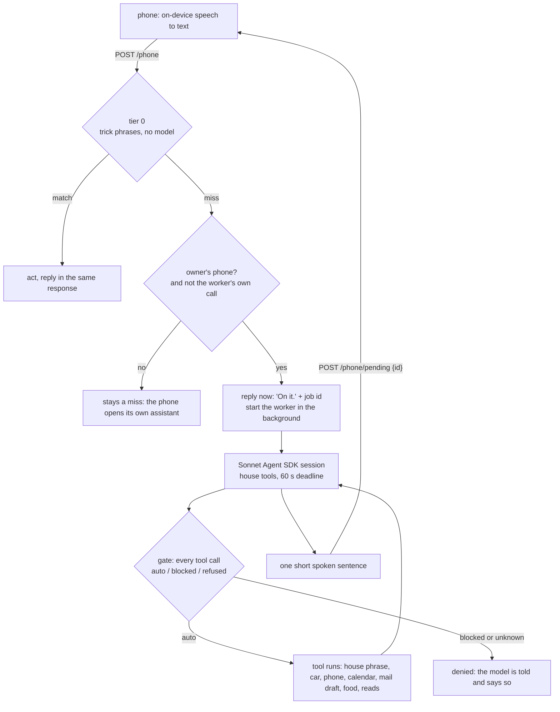

# The phone-miss worker

When I say a command to my phone and no phrase matches it, a Claude Sonnet session now answers it
with the house's tools, instead of the phone's stock assistant opening a search page. That path
has run in production since 2026-10-10. This page is the extracted, runnable version of it.

The worker is in `router/phone_worker.py`. Tool tiers are in `router/gate.py`. Connectors are in
`router/connectors/`. The phone-side glue is `router/phone_jobs.py` and `phone_server.py`.

## Flow



Three rules came from live mistakes, and each has a test:

- **Owner only, with a caveat.** A guest's miss never starts the worker, because the worker holds the
  owner's mail and calendar. A request that does not say who it is from is treated as a guest. But
  `who` is sent by the client, so it is advisory: **the bearer token is the real boundary**, and anyone
  who holds it can claim to be the owner. Give each person's phone its own token if you need a hard
  split; `phone_server.py` has one.
- **The worker's own `house` calls cannot start another worker.** They are sent with
  `no_claude`, otherwise a miss inside the worker would spawn a second one.
- **Dry runs never reach a write.** A "dry" test once sent a real navigation to a real car. Dry is now
  enforced once, in `ToolRegistry.run`, before any tool body runs.

## What it can do and what it cannot

This path does **not** ask out loud before it changes something. The phone has no way to answer a
question in the middle of a task, so the worker never asks. The room's rung 2 and 3 sessions do
ask (see the README); this one is built differently. Its safety is two things: it can only call
the tools it was given, and the things that go to someone else are blocked.

**It does without asking** (tier `auto`):

| Tool | What it changes |
|---|---|
| `house` | Runs a phrase the owner defined in the trick file: lights, scenes, media, car climate. It cannot invent an entity or a service call |
| `car` | Sends a destination or adds a stop. Reads never wake the car. There is no lock, unlock, trunk, window, honk, flash or sentry action |
| `phone_do`, `phone_open` | Timer, alarm, open an app, put a page on the screen. Inputs are validated first |
| `calendar_add` | Adds an event to the owner's own calendar. Never with attendees, never notifying anyone |
| `mail_draft` | Saves a draft. The adapter has no send |
| `food` | Logs or deletes a food-diary entry. An amount outside 0 to 10 units is refused |
| `wish` | Appends a line to a local file |
| reads | `house_status`, `now_playing`, `calendar_list`, `mail_search`, `mail_get`, WebSearch, WebFetch |

**It cannot do, in any session** (tier `blocked`, passed to the SDK as `disallowed_tools`, which
takes precedence over allow rules and over the permission callback): send, reply to or forward mail,
trash or delete mail, answer or change a calendar invite, delete an event, share or delete a Drive
file, change a Spotify library. Production also blocks click, type, shell and reboot tools on remote
PCs; those tool names are not in this repo. A tool that is in no tier is refused by default.
`tests/test_phone_worker.py` asserts the mail and calendar refusals against the gate, checks that
no fake backend was touched, and checks that the Drive and Spotify names reach `disallowed_tools`.

**Where a question is still asked.** A trick marked `confirm: true` needs a spoken yes. From the phone
that is refused out loud ("I can't confirm that from the phone."), never assumed. A bigger job
handed off with `delegate` investigates first and runs only after "go ahead" and then "computer,
confirm" (`gate.PlanSlot`). That runner is not in this repo. In production its shell deny list is
a regex, which is not a sandbox: the read-back and the second yes are the real control.

The SDK has three permission layers and they interact. `allowed_tools` approves a tool **before** the
callback runs, so a tool in it never reaches `can_use_tool`. That is the point of the `auto` tier
here. In the room's sessions the same fact is a trap: putting `Bash` in `allowed_tools` silently
skipped the spoken question (I measured it, in the README), so that roster goes in `tools=`.
`ToolPolicy.sdk_kwargs()` keeps a rule-bound tool such as calendar-add out of `allowed_tools`, so
its rule always runs.

## How often it ran

Counted with `tools/measure_phone_jobs.py` on the production log, read 2026-10-16:

| | n |
|---|---:|
| Phone jobs started, 2026-10-10 19:04 to 2026-10-15 18:22 | 67 |
| ...answered by a regex intercept ("go ahead", "confirm"), no model | 14 |
| ...started a Sonnet session | 53 |
| ...of those, with at least one tool call | 41 |

Of the 53 sessions, 49 fall on 10-10 and 10-11, the two days I built and tested this. **Tests are mixed
in.** I drove scripted requests through the same endpoint and the log cannot tell a test from a real
request, so I am not quoting a share of real use. The 4 sessions after 10-11 (one on 10-13, one on 10-14, two on 10-15)
are the least likely to be tests, though I cannot show that none are, and four is too few to say anything about.

What the 53 sessions did, from the log's own fields: the worker's timer shows a median of 8.6 s and a
p90 of 17.2 s (n=53, longest 51.5 s). Tools called, most first: WebSearch 15, `house` 12, `car` 6,
`food` 3, then ones and twos for the rest. The log records tool names, not outcomes, so it
says nothing about how often the answer was right.

The production worker is Sonnet (`claude-sonnet-4-5` in the log). Override it with
`ROUTER_WORKER_MODEL`.

## Run it

```bash
pip install -r requirements.txt
python3 -m pytest -q                       # offline: no model, no device, no network
python3 demo_phone.py                      # a scripted model through the real tools and gate
python3 demo_phone.py --live "set a timer for ten minutes"
                                           # a real Sonnet session (needs `claude` logged in),
                                           # still against fake devices
```

`demo_phone.py` with no flag replays five synthetic requests. The model is replaced by a script of
the tool calls it would plausibly make, and two of them it must not be allowed to finish. The tools,
the registry and the gate are the real ones:

```text
> add dentist tomorrow at 3 PM
    house__calendar_add  [auto]  Added "Dentist" at 2026-10-17T15:00.
  say: Added Dentist tomorrow at 3 PM.
  fake calendar: [{"title": "Dentist", "start": "2026-10-17T15:00", "end": "", "description": ""}]
> send the landlord an email that rent is coming
    claude_ai_Gmail__send_message  [blocked]  DENIED: Not allowed from the voice assistant.
    house__mail_draft  [auto]  Draft saved. It is waiting in the drafts folder; nothing was sent.
  say: I cannot send email, but I saved a draft for you.
  fake drafts: [{"to": "landlord", "subject": "Rent", "body": "Rent is coming."}]
> invite Sam to dinner friday
    claude_ai_Google_Calendar__create_event  [blocked]  DENIED: No attendees: the owner's own calendar only.
  say: I cannot invite people, only add to your own calendar.
> send the car to the museum
    house__car  [auto]  Sent museum to the car.
  say: Sent the museum to the car.
  fake car: [["nav", "museum"]]
> set a timer for ten minutes
    house__phone_do  [auto]  Done on the phone.
  say: Ten minute timer is running on your phone.
  fake phone: [["timer", "600", "timer"]]
```

The script, not a model, chose those tool calls. This shows the gate and the tools. It does not show
that Sonnet would choose them.

To serve it to a phone (loopback only; reach it over a VPN you already run, never an open port):

```bash
export ROUTER_PHONE_TOKEN=$(python3 -c "import secrets; print(secrets.token_urlsafe(32))")
python3 phone_server.py --fake-backends     # a real model, fake devices
python3 phone_server.py                     # real devices, from ROUTER_HA_URL, ROUTER_HA_TOKEN,
                                            # ROUTER_KODI_URL, ROUTER_CAR_CMD, ROUTER_ADB_SERIAL
```

```bash
curl -s -H "Authorization: Bearer $ROUTER_PHONE_TOKEN" -d '{"text": "movie night"}' 127.0.0.1:7783/phone
curl -s -H "Authorization: Bearer $ROUTER_PHONE_TOKEN" -d '{"id": "<pending id>"}' 127.0.0.1:7783/phone/pending
```

## Adding a tool

1. Write `router/connectors/<name>.py` with a small backend protocol (a few methods), a function that
   validates its arguments and calls the backend, and `register(reg, backend)`.
2. In `register`, say honestly what the tool is: `writes=True` (or `writes=fn(args)` when only some
   calls write), and `tier=`. If it leaves the house or cannot be undone, do not register a tool at
   all: add the hosted tool's name to `BLOCKED` in `connectors/hosted.py`.
3. A failed tool returns the exception class name, never the message. The registry does that for you.
4. Add a fake to `router/fakes.py`, pass the backend through `build_registry`, and write a test that
   shows a dry run leaves the fake untouched.
5. Add a row to [CAPABILITIES.md](CAPABILITIES.md).

## What is not here

- The conversational version. In production, since 2026-10-11, the phone reaches one warm session that
  keeps three minutes of context, so "the second one" and "what about Tuesday" work, and a reply that
  ends in a question makes the phone listen again. This repo has the one-shot worker.
- The hand-off runner and the build-by-voice pipeline. `gate.PlanSlot` is the two-yes slot they share.
- The real Home Assistant entity map, the Kodi library matcher, the root-over-ssh phone helper.
- A live run of `SdkRunner` in this repo. The tests build its options against a stand-in SDK and check
  the three permission layers; the first real session you start is the first time that code reaches the
  model.
