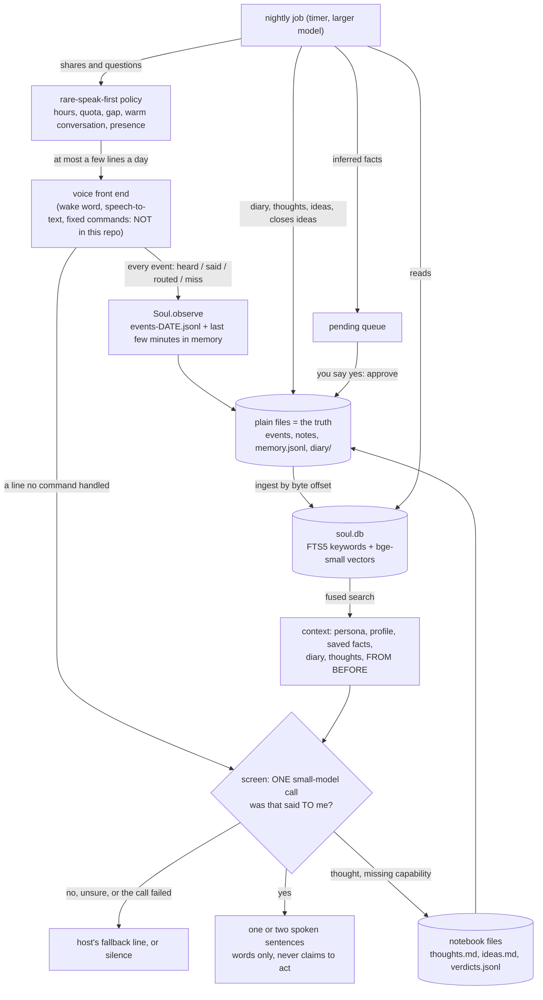

# soul

A local memory layer for a voice assistant: it decides whether a missed line was meant for the assistant, remembers what it has heard, reflects overnight, and only speaks first rarely.

> **Status: in testing.** The system this comes from has run on my home voice setup since early October 2026 and keeps changing. This extracted, generalised package passes its offline tests (below). It has **not** been run against a live model since the rewrite: the prompts were reworded to remove everything specific to my house, and the original measurements do not carry over to the new wording.

## Why I built it

My voice assistant at home handles fixed commands well: lights, TV, media. Everything else it heard used to be dropped or got a canned "sorry". Most of what falls through is not for the assistant at all: the TV, people talking to each other, a phone call, speech-to-text garbage after a false wake. In the 11 missed lines I replayed on 2026-10-05, 8 were chatter and 3 were real requests.

I wanted the leftovers handled the way a person who lives in the house would handle them. Notice when someone is actually talking to it. Answer briefly, and be honest about what it cannot do yet. Remember. Keep a notebook of its own. And never talk when nobody asked, because a voice that chimes in on a TV show is worse than silence.

So this is the part that sits behind the commands. It started as one file on 2026-10-05, and on 2026-10-09 I added a searchable memory database and decided three things: search by meaning plus keywords, run locally; facts it infers about me wait for my yes (its own notebook thoughts do not: they are kept and read back into its prompts); and it may speak first only rarely.

## How it works



**The files are the truth, the database is an index.** Every writer appends to plain files in one data directory: `events-DATE.jsonl`, `thoughts.md`, `ideas.md`, `memory.jsonl`, `diary/DATE.md`, `verdicts.jsonl`, and a hand-edited `profile.md` and `persona.md`. `soul.db` is built from them by byte offset, so nothing on the hot path changes and deleting the database loses nothing. State that only the database holds (idea states, queued and decided facts, what was spoken) is mirrored to `ledger.jsonl` and replayed into a fresh database. The tests cover that (`TestLedger`).

**Hybrid recall** (`store.py`, `recall.py`). SQLite FTS5 (BM25, Porter stemming) gives keyword hits. `bge-small-en-v1.5` (quantised ONNX, CPU, two threads, runs locally) gives a meaning vector per line. The two ranks are fused with reciprocal rank fusion, so a paraphrase finds the line and an exact name still wins. Vectors are cached in memory and topped up incrementally. With no model installed the search degrades to keyword-only instead of failing; the demo below shows both modes on the same question.

**The screen** (`screen.py`). One stateless call to a small model per missed line. The prompt makes it decide first whether the line was addressed to the assistant (strictly: unsure means no, and then it says nothing beyond whatever fallback line the host would have said anyway), and only then write a short spoken reply. It reads the last few minutes of events, a capability list from your config, and its own memory, so a fragment like "the hall too" right after a lights command is understood as a continuation. It can say a thing cannot be done, and record the gap, but it cannot act: the prompt forbids anything that sounds like a command being carried out. The result is a `Verdict` with a `speak` field (the reply, else your fallback line, else empty). A failed or timed-out call (default 8 s) speaks the fallback. Replies pass through `speakable()`, which strips code, paths, URLs and flags before anything is read aloud.

**The nightly job** (`nightly.py`). Once a day, one larger-model call reads yesterday's events, the screen's gap ledger, requests that were repeated within two minutes, what it already knows (confirmed, queued, and rejected facts), older notes that mean the same as today's talk, its open ideas, and its own questions. It returns one JSON object: diary, thoughts, ideas, idea closures, facts, shares, questions. The reply is applied conservatively:

- Facts are **queued, never saved** (`facts.py`). `python3 -m soul pending` lists them, `approve` writes one to `memory.jsonl`, `reject` remembers it as a no and shows it to the next night as "never propose it again". A paraphrase of anything known, queued or rejected is dropped before it is queued.
- An idea close is accepted only for an id the model was shown. A new idea that means the same as an existing one is dropped.
- The diary file is written last, so its existence means the night is done. An unusable reply raises (exit 1), so a timer with `Restart=on-failure` retries the night instead of silently skipping it.

**Rare-speak-first** (`policy.py`). The nightly writes a few `shares` (a connection it noticed) and `questions` (things it wonders about you). The policy lets one out only inside configured hours, only while you have just talked to it, at most a per-day quota (drawn per calendar date so a restart does not re-roll it), with a minimum gap, only when an optional presence check says someone is home, and with shares and questions taking turns (at most one question a day). Every line it speaks is written to a ledger the next decision reads. The defaults are 1 to 3 a day between 09:00 and 21:00, at least two hours apart. All of it is in `soul.toml`.

### Design decisions, with where they come from

- **Screen first, in one call.** On 2026-10-05, with a plain speak-or-not prompt, a larger model spoke on 7 of the 8 chatter lines I replayed. The screen-first prompt on the small model was correct on all 11 lines on every one of at least 8 runs that day. On 2026-10-10 the same 11 lines scored 11 and 10 out of 11 on the committed code, and 8, 9 and 9 on a branch with an identical reply prompt; my notes call that model noise, and the misses were addressed lines going silent, not chatter speaking. n=11 distinct lines from one household: a sanity check, not a rate.
- **No unprompted speech beyond the rare share.** An earlier version of my setup asked unprompted questions; they captured the room and I cut them on 2026-09-03.
- **Inferred facts wait for a yes.** My decision on 2026-10-09. An earlier version appended inferred notes straight to my profile; that is gone. This covers facts only. Its notebook thoughts (one sentence about me or about its own misses, written after screened lines and in the nightly) are saved without asking, searched, and the newest few are put into later prompts. The screen and nightly prompts forbid thoughts about things overheard from other people, but that is an instruction to a model, not a filter.
- **Duplicate thresholds are hand-set, not tuned.** 0.85 cosine for "same fact" and 0.90 for "same question" come from a handful of pairs I looked at (a paraphrase scored 0.97 and an unrelated habit 0.72 in my data; on this repo's invented fixture household, two differently worded cello questions score 0.888 with the bundled model, checked 2026-10-16, n=1, so under the 0.90 cutoff both would be asked and the nightly's own question list does the rest). The nightly was proposing the same idea on consecutive nights, which is why ideas are deduplicated at all. If you change the embedding model, re-check them.

## Evidence

Everything here was run on 2026-10-16 on a 12-thread x86-64 desktop CPU, Python 3.13.5.

| what | result |
|---|---|
| Offline test suite, no model installed | `OK`, 4 tests skipped (they need the model) |
| Same suite with the model installed by `get-model` | `OK`, none skipped |
| `get-model` | downloaded both files at the pinned revision, SHA-256 matched the pinned values |
| `python3 -m soul demo` | ran; output below |
| `systemd-analyze verify --user` on both units in `deploy/` | no output, exit 0, with `ExecStart` pointed at an interpreter that exists here (the shipped `.venv` path is yours to create). Syntax only; the units were never started |
| Index timing, `python3 -m soul.tools.bench`, n=2000 synthetic lines, 2 embedding threads, 2 runs | embedding all 2000: 8.0 and 7.8 s; sync 0.07 s; then 50 warm searches per run (query embedding included): median 22 and 26 ms, p95 32 and 48 ms; database 4.8 MB |

What the tests are: 108 tests over a scripted model client and a hashing stand-in for the embedder, four of them against the real embedding model (they skip when it is not installed). They prove what the code does with a model's answer: silence when unsure, the fallback line on failure or timeout, nothing that looks like code is spoken, facts are queued and not saved, ideas are deduplicated, the diary is written last, quota and hours and gaps are enforced. They do **not** prove that a real model judges chatter correctly. That is `tools/screen_eval.py`: it scores the screen prompt on invented cases with your API key, and it has not been run. The real-model client (`llm.py`) is a thin wrapper tested only against a stub of the `anthropic` package; no live API call was made from this package.

The 11/11 above was measured on the original prompt, on real lines from my house. Those lines are a transcript of my home and are not in this repo, so you cannot reproduce that number from here. The prompt in this repo is a rewritten, generalised version and has not been scored.

## Install

You need Python 3.11 or newer and an [Anthropic API key](https://console.anthropic.com/) for the live parts (screen, "do you remember" answers, nightly). Search, the demo and the tests need no key and no network once the model file is downloaded. No microphone is needed: this package is the memory behind a voice front end, not the front end.

1. Get the code (green **Code** button, then **Download ZIP**, or `git clone`), and open a terminal in the folder that **contains** `soul/`.
2. Make a private Python environment and install the requirements:
   ```
   python3 -m venv .venv
   . .venv/bin/activate
   pip install -r soul/requirements.txt
   ```
3. Download the embedding model (two files, about 35 MB, from [Xenova/bge-small-en-v1.5](https://huggingface.co/Xenova/bge-small-en-v1.5) on Hugging Face, an ONNX export of BAAI's bge-small-en-v1.5; the original is MIT-licensed, the export's own page lists no licence). It is not stored in this repo:
   ```
   python3 -m soul get-model
   ```
   It goes to `~/.local/share/soul/models/bge-small-en-v1.5` and is checked against a pinned SHA-256. Skip this step and everything still runs, with keyword-only search.
4. See it work, no key needed. It builds an index over a few invented days and asks three questions:
   ```
   python3 -m soul demo
   ```
   With the model installed the output looks like this (first two of the three queries, copied from a real run; dates are relative to the day you run it and the temporary folder changes; the numbers are fusion scores, only their order matters):
   ```
   search mode: keyword + meaning (bge-small found)
   > Mochi vet appointment   (exact words: keyword search finds it)
       10-07 memory   0.0333  Mochi's vet appointment is the first Thursday of the month.
       10-15 heard    0.0328  Did you feed Mochi already?
       10-13 heard    0.0323  Remember that the vet is on the first Thursday.
   > when does the animal see the doctor   (shares no word with "vet": needs the meaning model)
       10-13 heard    0.0167  Remember that the vet is on the first Thursday.
       10-07 memory   0.0164  Mochi's vet appointment is the first Thursday of the month.
       10-14 said     0.0161  Mild and dry until Sunday evening.
   ```
5. Run the tests:
   ```
   python3 -m unittest discover -s soul/tests -t .
   ```
6. Make it yours. Copy `soul/soul.example.toml` to `~/.config/soul/soul.toml` and set `user_name`, `wake_word`, and `capabilities` (what your voice front end can do, so the screen can tell "say it like this" from "I cannot do that yet"). Then `export SOUL_CONFIG=~/.config/soul/soul.toml`. Edit `profile.md` and `persona.md` in the data folder (`python3 -m soul where`); every reply reads them.
7. Connect your voice front end. It hands the soul each event and each missed line, and speaks what comes back:
   ```python
   from soul import Soul, Config
   s = Soul(Config.load())                                   # needs ANTHROPIC_API_KEY for live calls

   s.observe({'ts': t, 'kind': 'heard', 'text': 'lights on in the living room'})   # heard | said | routed | miss
   v = s.screen('the hall too', stage='unclear', fallback="Sorry, I missed that.")
   say(v.speak)                                               # '' means stay silent
   line = s.share_due(last_talk_ts=t)                         # (id, text), or None almost always
   if line:
       say(line[1]); s.share_said(*line)
   ```
   Run `python3 -m soul` with no arguments for the command list. The ones you will use: `pending`, `approve all`, `reject 3`, `search "..."`, `ask "do you remember ...?"`, `nightly`.
8. Schedule the nightly job. `deploy/soul-nightly.service` and `.timer` are systemd user units (04:10 daily, retries every 30 minutes on failure). Edit the paths, put `ANTHROPIC_API_KEY=<your key>` in the env file the service names, then `systemctl --user enable --now soul-nightly.timer`. Review what it learned with `python3 -m soul pending`.

Cost: each missed line that reaches the screen is one small-model call, each "do you remember" is one, and the nightly is one larger call a day. I have not measured the spend for this package.

## What is not included, and why

- **The voice front end**: wake word, speech-to-text, text-to-speech, the fixed command router. It is a separate system; this package only needs its events. The routing core of it is the rest of this repository.
- **House-specific features** of the original, because they are tied to one home's devices and accounts: the TV and video taste learner, show recommendations, reminders, a morning check-in (calendar, weather and similar), advice after a command using live home-automation readings, and the offer-to-build path where a spoken yes starts a coding job.
- **A presence detector.** There is a hook (`presence=` on `Soul`) and the policy honours it; what counts as "someone is home" is yours to supply.
- **The offline gap-clustering prototype** from the original. Gaps are recorded (`verdicts.jsonl`) and fed to the nightly, but nothing clusters them on its own.
- **My data.** The notebook, the transcripts, the profile and the persona. Every fixture here is invented (`fixtures/household.json`: a made-up household, relative dates).
- **The embedding model.** Third-party; `get-model` downloads and verifies it.
- **A live-model evaluation of the rewritten prompts**, and any cost or latency figure for live calls. Not run.

## Built with Claude Code

I made the product decisions above. Claude Code wrote most of the code, including this extraction from my private working code and its tests.

## License

MIT, see [LICENSE](LICENSE).
